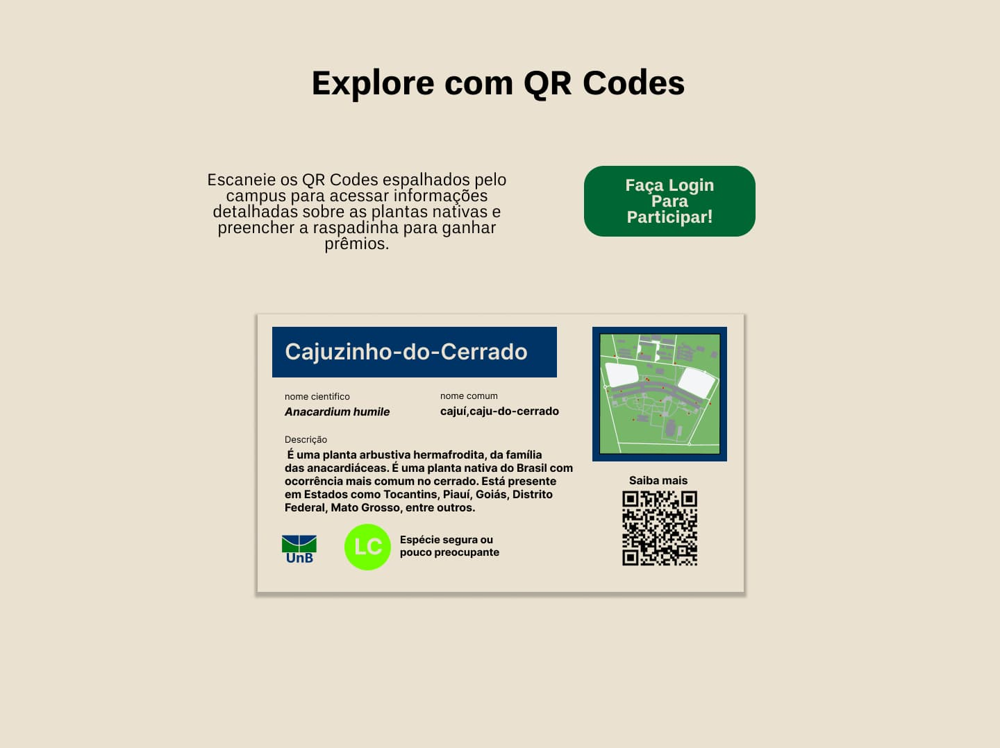
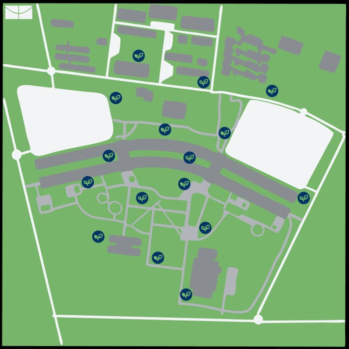
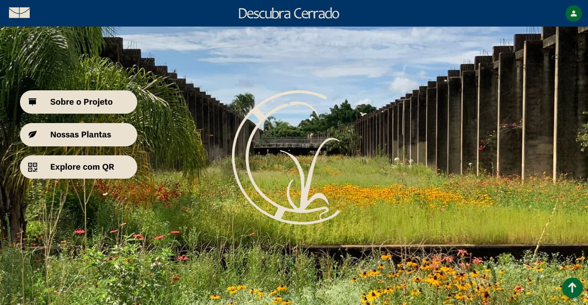

## Contexto e Problema

O **Descubra Cerrado** é uma campanha físico-digital para aproximar a comunidade da UnB do bioma do campus. O ponto de partida foi um dado que passa despercebido: das **33 espécies semeadas no Jardim de Sequeiro** do ICC Norte, o trecho de maior circulação da universidade, **só 8 são nativas do cerrado**, e quase ninguém que passa por ali sabe disso.

Daí a pergunta que orientou o projeto: *como transformar a passagem diária pelo ICC em contato real com o cerrado?* A resposta foi um sistema em três camadas: totens junto às plantas, um site com o acervo das espécies e uma raspadinha que recompensa quem completa o percurso com uma muda nativa.

## Decisões de Design

### 1. Do físico ao digital, no caminho de sempre

Os totens ficam junto às plantas que a comunidade já cruza no ICC Norte. Cada um traz nome científico, mapa e um QR code que abre a página da planta no site.

### 2. Gamificação que replanta

O visitante raspa no mapa cada planta encontrada. Quem completa o percurso troca o cartão por uma **muda ou semente nativa** no viveiro da UnB: o prêmio planta mais cerrado.

### 3. Identidade que nasce do bioma

Paleta tirada da paisagem, com UnB Pro e Cardone. Badges coloridos com o status de conservação da IUCN ensinam a escala de risco sem precisar de texto.

## Processo e Pesquisa

### Descoberta

- Levantamento do Jardim de Sequeiro: 33 espécies semeadas, só 8 nativas
- Mapeamento das gramíneas nativas do jardim
- Escolha do ICC Norte, o ponto de maior circulação do campus
- Público amplo, de alunos à comunidade externa: linguagem acessível sem perder o rigor científico

### Arquitetura de informação

- Site em três seções: Sobre o Projeto, Nossas Plantas e Explore com QR Codes
- Página da planta com fotos, onde achar na UnB, status IUCN e classificação científica
- Perfil com plantas descobertas, plantas restantes e como resgatar o prêmio

### Sistema visual e peças

- Paleta areia, azul institucional e verde cerrado
- Badges IUCN iguais nos totens e no site
- Totem validado em render 3D no local real, para checar escala e legibilidade

## Resultado e Aprendizados

A entrega cobre o ciclo inteiro da campanha: protótipo do site em desktop e mobile, totem com render 3D, raspadinha e identidade visual documentada. A estrutura pode ser replicada em outros jardins e universidades.

### Limitações

- Sem teste de usabilidade
- Totens não fabricados e site não implementado
- A raspadinha depende de uma operação (impressão, reposição, brindes e login) que não foi prototipada

### O que eu faria diferente

Testaria a dinâmica antes de refinar as telas. A raspadinha passa por três pontos (totem → site → viveiro), e cada passagem é um lugar onde as pessoas podem desistir. Um teste com cinco pessoas no ICC mostraria se a mecânica se explica sozinha.

## Protótipo Interativo

Os protótipos abaixo são navegáveis dentro da página (desktop e mobile). Para ver em tela cheia, use o botão logo abaixo deles, que abre o protótipo no Figma.

  <iframe src="https://embed.figma.com/proto/NYr9lYp3VnO51mE6X9BmhV/Projeto-ID---Descubra-Cerrado?node-id=18-535&scaling=scale-down-width&content-scaling=fixed&page-id=0%3A1&starting-point-node-id=18%3A535&embed-host=share&hide-ui=1" loading="lazy" title="Protótipo desktop do Descubra Cerrado" allowfullscreen></iframe>

  <iframe src="https://embed.figma.com/proto/NYr9lYp3VnO51mE6X9BmhV/Projeto-ID---Descubra-Cerrado?node-id=17-511&scaling=scale-down-width&content-scaling=fixed&page-id=0%3A1&starting-point-node-id=17%3A511&embed-host=share&hide-ui=1" loading="lazy" title="Protótipo mobile do Descubra Cerrado" allowfullscreen></iframe>

<a class="btn ghost" href="https://www.figma.com/proto/NYr9lYp3VnO51mE6X9BmhV/Projeto-ID---Descubra-Cerrado?node-id=18-535&t=bqRoOGEMgPRJJ1Bh-1&scaling=scale-down-width&content-scaling=fixed&page-id=0%3A1&starting-point-node-id=18%3A535" target="_blank" rel="noopener noreferrer">Abrir em tela cheia no Figma ↗</a>

