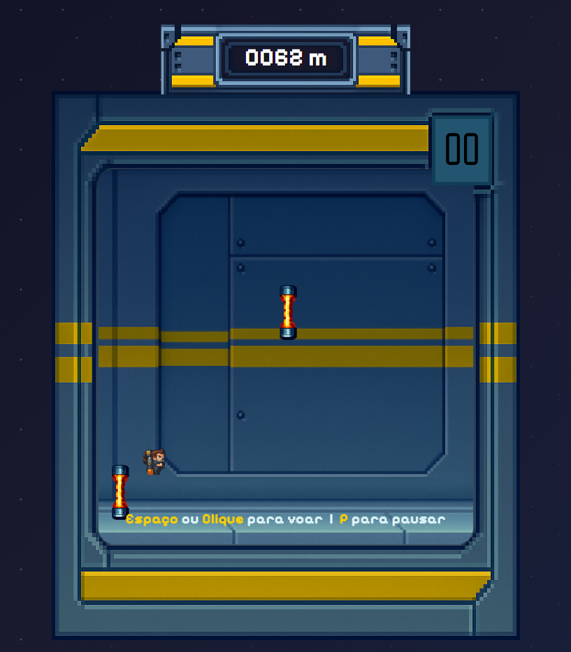
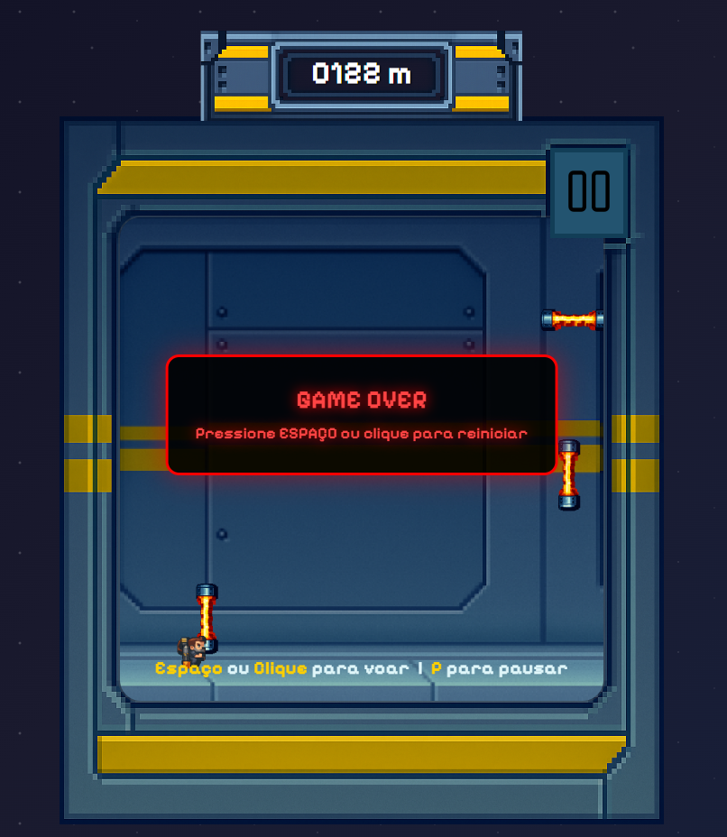
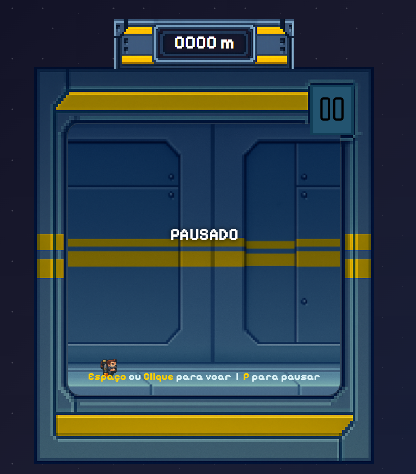

## Introdução

O **JetPack Guy** é uma recriação web do JetPack Joyride em pixel art, feita com WebGL puro, HTML e CSS. O objetivo foi unir um jogo de verdade (física, obstáculos e pontuação) ao estudo do pipeline gráfico de baixo nível: shaders, buffers e atributos.

## Ideia Principal

### 1. Pixel art como dado



Os sprites são listas de pixels em JSON desenhadas com `gl.POINTS`. Isso preserva a estética e obriga a lidar com coordenadas, cores e buffers, o que uma engine costuma esconder.

### 2. Jogo separado do rendering



Gravidade, salto, obstáculos e pontuação ficam no JavaScript; os shaders só posicionam e colorem. A CPU atualiza o estado e a GPU desenha o frame.

### 3. Interface em CSS



Moldura, placar e layout responsivo são HTML e CSS, por cima do canvas. O placar precisa ser legível durante o jogo: hierarquia e contraste fazem parte da experiência.

## Detalhes Técnicos

### Pipeline WebGL

- Pixel → clip space (−1 a +1), com o eixo Y invertido
- Buffers `Float32Array` para posição e cor
- Vertex shader com posição, translação e cor; fragment shader simples
- Cenário e obstáculos com `gl.LINES`

### Lógica de jogo

- `requestAnimationFrame` a cerca de 60 fps
- Física de Euler: `y += velocity; velocity += gravity`
- Impulso no Espaço ou na seta para cima
- Obstáculos voltam em altura aleatória; a velocidade cresce com a pontuação

### Visual e interface

- Sprites como pontos coloridos, com `gl_PointSize` ajustável
- Pontuação em metros e moldura em CSS, fora do canvas
- Telas próprias para jogo, pausa e game over

### Performance

- `gl.STATIC_DRAW` para dados carregados uma vez
- Nenhuma alocação por frame: arrays criados na carga
- Shaders mínimos; para crescer, texture atlas ou instancing

## Como Executar

### Pré-requisitos

- Node.js (para `npx serve`) ou Python 3
- Navegador moderno com suporte a WebGL

É necessário um servidor local — `fetch` do `pixels.json` não funciona via `file://`.

### Passos

```
git clone https://github.com/Lucas-Balduino/JetPackGuy.git
cd JetPackGuy
npx serve .
```

Ou com Python:

```
python -m http.server 8000
```

Abra a URL indicada pelo servidor (ex.: `http://localhost:3000` ou `:8000`). Ajuste `gl_PointSize`, `baseVel` ou o intervalo de pontuação para testar dificuldade e performance.
