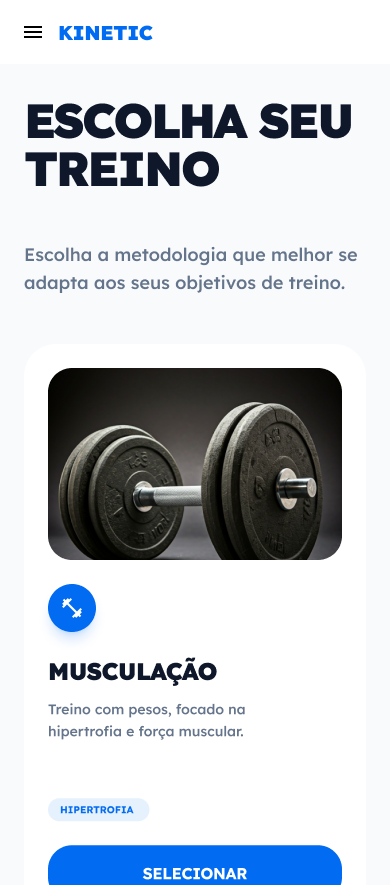
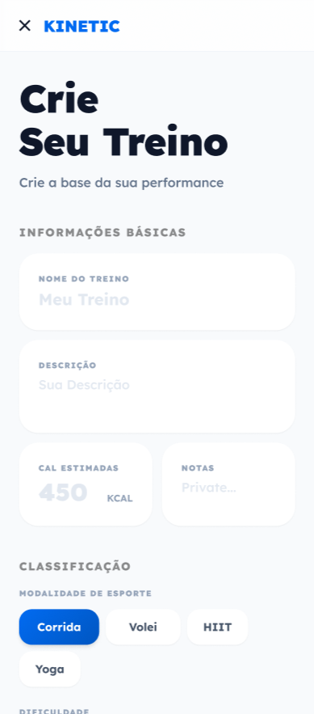
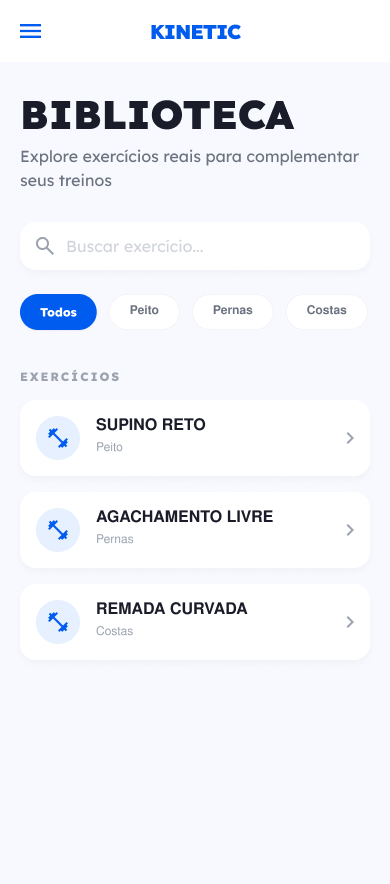

## Introdução

O **Kinetic** é um app mobile para montar e acompanhar treinos. Nasceu na disciplina de Programação para Dispositivos Móveis, mas foi conduzido como produto: interface consistente, fluxos claros e base técnica pronta para crescer.

O usuário cria conta, personaliza o perfil, explora uma biblioteca de exercícios (API Wger) e escolhe rotinas para seis modalidades (musculação, ciclismo, corrida, futebol, voleibol e natação) ou monta treinos próprios salvos na nuvem.

## Ideia Principal

### 1. Identidade por modalidade



Cada esporte tem paleta, ícones e rotinas próprios: ciclismo em laranja, natação em verde. A interface muda de contexto sem perder a estrutura.

### 2. Autonomia do usuário



Além das rotinas prontas, um formulário com sliders, seletores e anotações cria treinos próprios, sincronizados entre dispositivos pelo Firestore.

### 3. Design e código, o mesmo produto



O design system não ficou só no Figma: virou componentes no código, com hooks e services separando a interface da lógica de dados.

## Detalhes Técnicos

### Design system

- Lexend em quatro pesos para a hierarquia
- Primária #005CEE e um acento por esporte
- Cards de 16 a 24px, header único e 19 ícones SVG próprios
- Estados de carregando, erro com nova tentativa e lista vazia

### Stack

- React Native + Expo SDK 55
- Firebase Auth, com a sessão salva no AsyncStorage
- Cloud Firestore para perfil e treinos
- API Wger (REST) na biblioteca de exercícios

### Arquitetura

- `screens/`: 7 telas
- `components/`: switch, picker, drawer e loading
- `navigation/`: stacks de autenticação, início e biblioteca, mais o drawer
- `services/` e `hooks/`: Firebase, animações e busca na Wger

### Navegação, dados e segurança

- Sem login, AuthStack; com login, drawer com Início, Biblioteca e Perfil
- Chamadas assíncronas sempre com feedback de carregando e erro
- Wger com prioridade para a tradução em português
- Chaves no `.env` e regras do Firestore por usuário

## Protótipo Interativo

O protótipo abaixo é navegável dentro da página. Para ver em tela cheia, use o botão logo abaixo dele, que abre o protótipo no Figma.

<div class="figma-embed figma-embed--mobile">
  <iframe src="https://embed.figma.com/proto/G5rbfqVZCH4n5p57Hpr3ZL/Untitled?node-id=4082-191&scaling=scale-down-width&content-scaling=fixed&page-id=0%3A1&starting-point-node-id=4082%3A191&embed-host=share&hide-ui=1" loading="lazy" title="Protótipo interativo do Kinetic" allowfullscreen></iframe>
</div>
<p class="figma-open"><a class="btn ghost" href="https://www.figma.com/proto/G5rbfqVZCH4n5p57Hpr3ZL/Untitled?node-id=4082-191&scaling=scale-down&content-scaling=fixed&page-id=0%3A1&starting-point-node-id=4082%3A191" target="_blank" rel="noopener noreferrer">Abrir em tela cheia no Figma ↗</a></p>

## Como Executar

### Pré-requisitos

- Node.js
- Expo Go (dispositivo ou emulador)
- Projeto Firebase com Auth (email/senha) e Firestore

### Passos

```
git clone https://github.com/Lucas-Balduino/FitnessApp.git
cd FitnessApp
npm install
cp .env.example .env
```

Preencha o `.env` com as chaves Firebase (`EXPO_PUBLIC_FIREBASE_*`), configure as regras do Firestore no console e rode:

```
npx expo start
```
