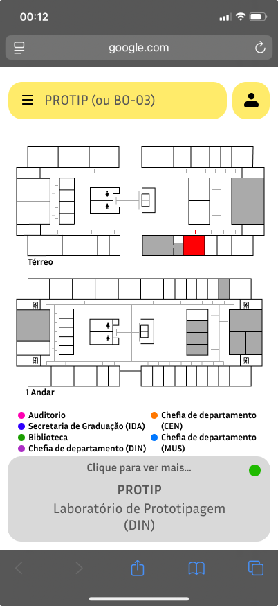
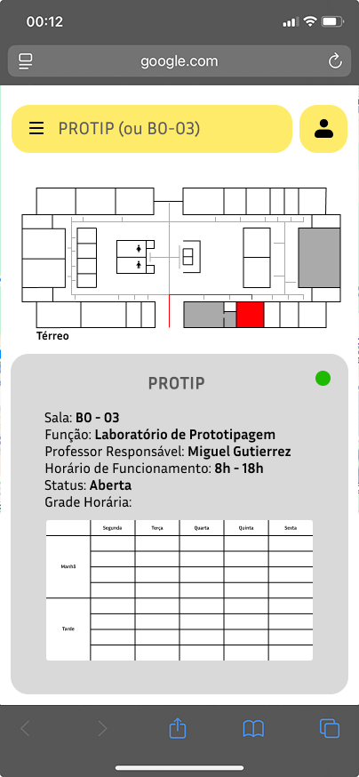
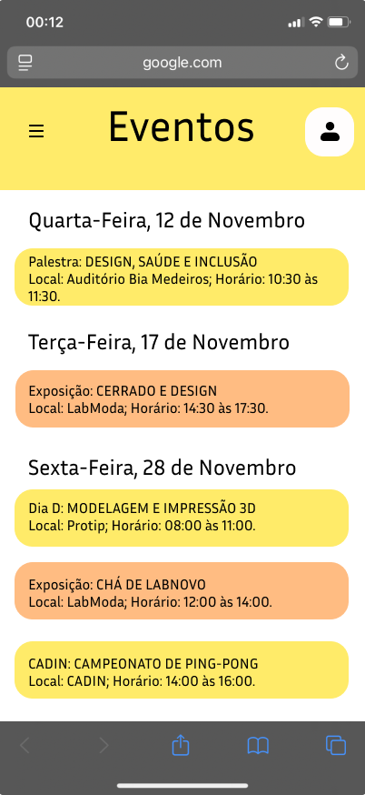

## Contexto e Problema

O novo prédio do curso de Design da UnB foi inaugurado sem sinalização padronizada, e alunos, professores e visitantes se perdem nele. Placas, pinturas e totens estavam fora de questão: dependem de burocracia e de garantia estrutural de um prédio recém-entregue.

> Como melhorar a orientação em um prédio sem poder tocar no prédio?

A resposta foi um **mapa digital**, aberto por QR code nas entradas e pelo site do curso: de baixo impacto, atualizável e com informação que placa nenhuma carrega.

## Decisões de Design

### 1. A busca é a porta de entrada

Quem chega quer achar a sala AO-05 agora. A tela inicial é a planta do andar com a busca fixa no topo; o menu fica como caminho secundário.

### 2. Informação viva, não gravada

Uma placa diz onde a sala está; o card diz **o que acontece nela**: função, professor, horário, grade e status aberto/fechado.

### 3. Orientar e criar pertencimento

Sem sinalização, o curso também perde identidade no espaço. Por isso o mapa virou app institucional, com eventos, galeria, história e contatos na identidade do Design UnB.

## Processo e Pesquisa

### Descoberta

- Conversa com o chefe do departamento, que descartou a solução física
- Observação de campo: onde as pessoas hesitam
- Benchmark: sinalização do ICC e apps de orientação de outras universidades
- Mapeamento de salas, ateliês, laboratórios e acessos

### Arquitetura de informação

Duas perguntas guiam a estrutura: as de urgência ("onde é a sala X?") e as de contexto ("tem evento hoje?").

- Mapa com busca e card por sala
- Onde fica o IdA, Eventos, Galeria, Sobre e Contato
- Perfil com "Minhas Salas"

### Sistema visual

- Amarelo institucional como único acento; cinzas no resto, para o mapa não competir com a interface
- Uma cor por tipo de espaço, com legenda fixa
- Status sempre com cor **e** texto, para não excluir quem tem daltonismo

### Acesso sem instalação

QR codes nas entradas e nos corredores, link no site do curso e, no futuro, totens. Tudo sem intervir fisicamente no prédio.

## Resultado e Aprendizados

O protótipo navegável no Figma cobre o fluxo completo: chegar ao prédio, buscar a sala, entender o que acontece nela e acessar a informação do Instituto.

### O que o digital resolve

- **Atualização contínua:** mudar de sala é editar conteúdo, não fazer obra
- **Informação do momento:** grade, status e eventos do dia
- **Sem instalação:** acesso por QR code

### Limitações

- Sem teste de usabilidade: decisões baseadas em observação e benchmark
- Cobre só o térreo; falta o seletor de andar
- Recursos de acessibilidade previstos, não implementados
- O status aberto/fechado depende de dados que a instituição ainda não tem

### O que eu faria diferente

Começaria com um teste de corredor: cinco pessoas, uma tarefa ("ache a sala AO-05"). Provavelmente descobriria que as pessoas chamam os espaços pelo nome ("o laboratório de prototipagem"), não pelo código, e a busca seria por nome desde o início.

## Protótipo Interativo

O protótipo abaixo é navegável: use a busca para localizar uma sala no mapa do térreo, ou percorra as seções de eventos, galeria e contatos pela barra inferior. Para ver em tela cheia, use o botão logo abaixo dele, que abre o protótipo no Figma.

  <iframe src="https://embed.figma.com/proto/DqVEE5LjFYWZokVglrf9mV/Projeto-Novo-Ida?node-id=17-164&scaling=scale-down-width&content-scaling=fixed&page-id=0%3A1&starting-point-node-id=17%3A3&embed-host=share&hide-ui=1" loading="lazy" title="Protótipo interativo do Mapa Virtual do IdA" allowfullscreen></iframe>

<a class="btn ghost" href="https://www.figma.com/proto/DqVEE5LjFYWZokVglrf9mV/Projeto-Novo-Ida?node-id=17-164&t=x6QUaNiLbwlmRQKj-1&scaling=scale-down-width&content-scaling=fixed&page-id=0%3A1&starting-point-node-id=17%3A3" target="_blank" rel="noopener noreferrer">Abrir em tela cheia no Figma ↗</a>

